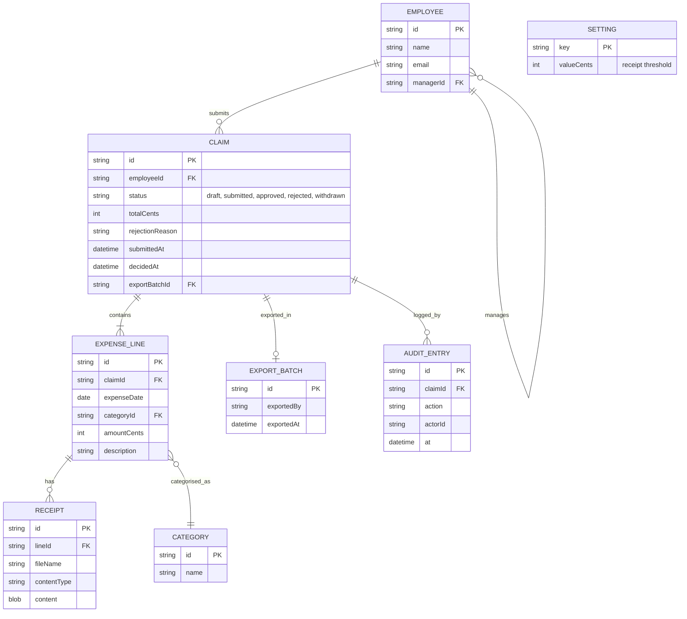

# Domain model

Employees own claims made of expense lines with receipts; managers decide them; finance exports approved ones. Amounts are in cents in one company currency (P2).

Employee `managerId` defines a manager's team. Receipts are stored in the database for the first version. The receipt threshold is a single setting held in SETTING.